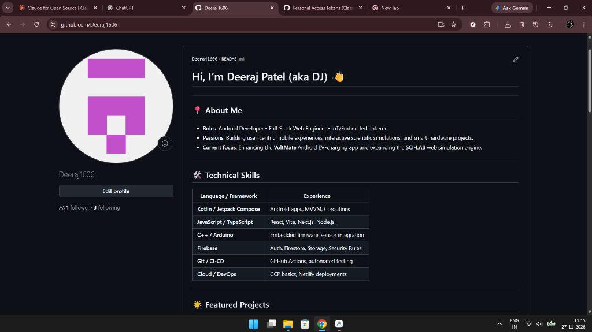

[](https://github.com/Deeraj1606/voltmate/actions) [](https://github.com/Deeraj1606/voltmate/actions) [](https://github.com/Deeraj1606/voltmate/blob/main/LICENSE) [](https://github.com/Deeraj1606/voltmate/stargazers)\n\n# VoltMate âš¡



## Overview
VoltMate is an **open‑source Android application** that lets EV owners **share** idle home or shop chargers with other Tata EV drivers. It demonstrates a complete end‑to‑end flow:
- **Driver** discovers chargers on an interactive map, books a slot, taps NFC, charges, and pays **in‑app**.
- **Owner** registers a charger, sets pricing & availability, earns from each session, and can withdraw simulated funds.
- All transactions are recorded in a **wallet** that works offline via `SharedPreferences` and syncs to Cloud Firestore when online.

### Key Features
- Real‑time charger map (OSMDroid) with distance filtering.
- Dual‑role dashboards (Driver & Owner) with demo data fallback.
- In‑app wallet with top‑up, payment, earnings, and simulated withdrawal flows.
- Secure authentication – Google Sign‑In via Credential Manager + Email/Password fallback.
- Offline‑first architecture with graceful error handling.
- Clean MVVM architecture using manual DI and `StateFlow`.

---

## Architecture
```mermaid
graph TD
    UI[UI (Compose + Material 3)] --> DI[DI Container]
    DI --> ViewModel[ViewModel (StateFlow)]
    ViewModel --> Repo[Repository Layer]
    Repo --> Firestore[Firestore (remote)]
    Repo --> Local[SharedPreferences (local)]
```

---

## Tech Stack
| Layer | Technology |
|------|------------|
| Language | Kotlin |
| UI | Jetpack Compose + Material 3 |
| Build | Gradle Kotlin DSL, Version Catalog |
| Auth | Firebase Auth (Google Sign‑In, Email/Password) |
| Database | Cloud Firestore (real‑time) |
| Location | Google Play Services Location + OSMDroid |
| Min SDK | 26 • Target/Compile SDK 35 |

---

## Getting Started
```bash
git clone https://github.com/Deeraj1606/voltmate.git
cd voltmate
# Open in Android Studio (Arctic Fox+)
# Add your firebase config (google-services.json) to app/
./gradlew :app:assembleDebug
```

---

## Contributing
Please see `CONTRIBUTING.md` for guidelines on fork‑PR workflow, code style, and testing.

---

## License
MIT License – see the `LICENSE` file.

