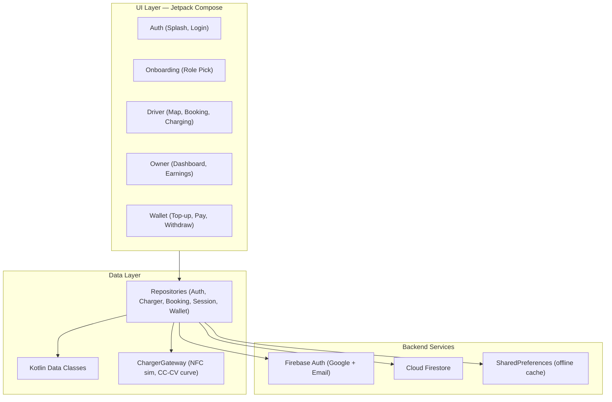

 VoltMate — EV Charger-Sharing Android App


An open-source Android app that lets EV owners **share idle home chargers** with other drivers. Drivers discover chargers on a live map, book slots, charge, and pay in-app. Owners register chargers, set pricing, earn revenue, and manage sessions — all with an offline-first architecture.

## App Architecture



## Features

- **Real-time charger map** — OSMDroid with distance-based filtering
- **Dual-role dashboards** — Driver and Owner views with instant demo data fallback
- **In-app wallet** — Top-up, payment, earnings, and simulated withdrawals
- **Secure auth** — Google Sign-In (Credential Manager) + email/password
- **Offline-first** — Demo data loads instantly; Firestore calls wrapped with 4s timeout
- **Simulated charging hardware** — NFC auth, CC-CV charging curve, real-time telemetry
- **Material 3 theming** — Green accent palette, consistent dark/light support

## Tech Stack

| Layer | Technology |
|-------|-----------|
| Language | Kotlin |
| UI | Jetpack Compose + Material 3 |
| Build | Gradle Kotlin DSL, Version Catalog |
| Auth | Firebase Auth (Google Sign-In, Email/Password) |
| Database | Cloud Firestore (real-time listeners) |
| Maps | OSMDroid + Google Play Services Location |
| DI | Manual dependency injection (AppContainer) |
| State | MVVM with StateFlow |
| Min SDK | 26 • Target SDK 35 |

## Project Structure

```
voltmate/
├── app/src/main/java/com/company/voltmate/
│   ├── MainActivity.kt              # NavHost with all routes
│   ├── VoltMateApp.kt               # Application class
│   ├── data/
│   │   ├── gateway/                  # Simulated charger hardware
│   │   ├── model/                    # Data classes (User, Charger, Booking, etc.)
│   │   └── repository/              # Auth, Charger, Booking, Session, Wallet repos
│   ├── di/                           # AppContainer (manual DI)
│   └── ui/
│       ├── auth/                     # Splash, Login screens + ViewModel
│       ├── onboarding/               # Role picker, driver & owner onboarding
│       ├── driver/                   # Dashboard, ChargerDetail, Booking, ChargingSession
│       ├── owner/                    # Dashboard, earnings, charger management
│       ├── wallet/                   # Wallet screen + ViewModel
│       ├── components/               # Shared components (MapView)
│       └── theme/                    # Colors, Typography, Theme
├── .github/workflows/
│   ├── ci.yml                        # Lint + unit tests
│   └── android.yml                   # Android build CI
└── gradle/libs.versions.toml         # Version catalog
```

## Getting Started

### Prerequisites

- Android Studio Hedgehog (2023.1) or later
- JDK 17+
- An Android device or emulator (API 26+)

### Setup

```bash
git clone https://github.com/Deeraj1606/voltmate.git
cd voltmate
```

1. Open the project in Android Studio
2. Add your `google-services.json` to `app/`
3. Sync Gradle and run on a device/emulator

> **Note:** The app works without Firebase configured — it falls back to built-in demo data automatically.

## License

MIT — see [LICENSE](LICENSE) for details.
